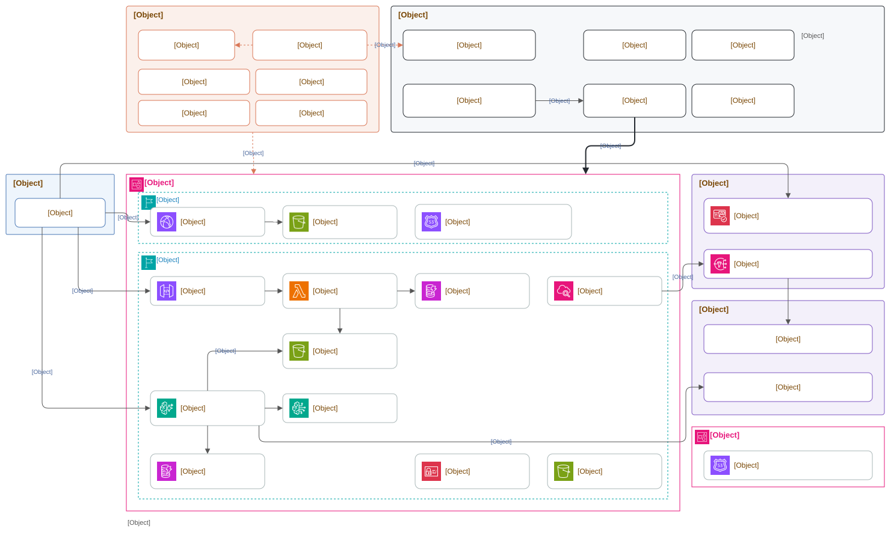

# sakekasu learning

資格試験（AWS / OCI / Terraform ...）の問題演習サイト。<https://learning.sakekasu-builder.com/>

- 招待制のログイン（4 アプリ共通のログイン `auth.sakekasu-builder.com`。Cognito のマネージドログイン）。MFA 必須（認証アプリの TOTP）。回答履歴をユーザーごとに記録し、直近2回の正誤で習熟度を判定する
- 問題文はそのまま、選択肢は毎回シャッフルして出題する。解説は回答後に折りたたみで表示する
- 問題ごとに AI（Bedrock の Kimi K3）に相談できる。AWS 公式ドキュメントを MCP で参照しながら答える
- AI への相談は 1 人あたり 1 日 50 回まで（日本時間の 0 時に戻る）。Bedrock の費用がかさまないよう、モデルを呼ぶ前に DynamoDB で数える（`agent/src/quota.py`）

## 習熟度の判定

| 直近の結果 | 判定 |
|---|---|
| 正解 → 正解 | バッチリ |
| 正解と不正解が混在 / 1回だけ回答して正解 | あいまい |
| 不正解 → 不正解 / 1回だけ回答して不正解 | 苦手 |
| 回答なし | 未回答 |

判定ロジックは [shared/mastery.ts](shared/mastery.ts)。

## 構成



[docs/architecture.drawio.svg](docs/architecture.drawio.svg) は draw.io（VS Code の Draw.io 拡張でも可）でそのまま開いて編集できる。
アカウント ID は図に書かない。

- すべてサーバーレス。固定費はほぼゼロで、ランニングコストの大半は Bedrock の利用料になる
- 正解と解説は回答を送信するまで API が返さない。採点もサーバーで行う
- AI チャットは問題の本文・正解・解説をクライアントから受け取らず、Runtime が非公開バケットから読む
- CloudFront の証明書は us-east-1 にしか置けないため、配信スタックだけ us-east-1。フロントは起動時に `/config.json` を読んで接続先を知るので、リージョンをまたいだスタック参照は無い

| スタック | リージョン | 内容 |
|---|---|---|
| `sakekasu-learning-dev-backend` | ap-northeast-1 | DynamoDB、問題データ用 S3、HTTP API + Lambda |
| `sakekasu-learning-dev-agent` | ap-northeast-1 | AgentCore Runtime（Python 3.13, CodeZip）、AI 相談の回数を数える DynamoDB |
| `sakekasu-learning-dev-web` | us-east-1 | ACM、S3、CloudFront、Route 53 レコード |
| `sakekasu-learning-github-oidc` | ap-northeast-1 | GitHub Actions 用ロール（手動デプロイ） |

ログインの接続先（共通ユーザープールの ID、learning 用のクライアント ID、ログイン画面のドメイン）は
`infra/cdk.json` の context `sharedAuth` に置く。共通基盤（sakekasu-integrated_environment）のスタックとは参照でつながない。
切り替えの経緯は [docs/shared-login.md](docs/shared-login.md) にある。

github-oidc 以外のスタックは [cdkd](https://github.com/go-to-k/cdkd) でデプロイする。CloudFormation を通さず各サービスの API を直接呼ぶので速い。
スタックの状態（リソースの対応表と出力）は CloudFormation ではなく S3 の `cdkd-state-<アカウント ID>` に置かれる。
github-oidc だけは CI 自身の権限を定義するため、手元から `cdk deploy`（CloudFormation）でデプロイする。

## 監視

アラームは backend と agent のスタックが持ち、共通基盤（sakekasu-integrated_environment）の SNS トピック
`sakekasu-integrated-alerts` へ ALARM と OK の両方を送る。共通基盤がそれを Slack に流す。
対象は API の Lambda（エラー・スロットリング）、HTTP API の 5xx、回答履歴の DynamoDB のスロットリング、
AI チャットの Runtime（システムエラー・スロットリング・認可失敗・呼び出し回数の急増）。アラーム一覧と閾値は
[docs/monitoring.md](docs/monitoring.md)、送り方の約束は共通基盤の
[docs/monitoring.md](https://github.com/yuuuuuuu168/sakekasu-integrated_environment/blob/main/docs/monitoring.md) にある。

## ディレクトリ

```
content/   問題データ（非公開リポジトリ sakekasu-learning-content の clone。このリポジトリには入れない）
shared/    web と Lambda で共有する型・習熟度判定
web/       フロントエンド（React 19 / Vite / Tailwind CSS v4 / aws-amplify）
infra/     CDK（TypeScript）、API Lambda、問題ビルドスクリプト
agent/     AI 家庭教師（Strands Agents / AgentCore Runtime）
```

## 問題の追加

問題文・選択肢・解説・図解は、非公開リポジトリ [sakekasu-learning-content](https://github.com/yuuuuuuu168/sakekasu-learning-content)
にだけ置く。このリポジトリには入れない（CI の `no-question-data` が止める）。
手元では `content/` に clone して作業する（`git clone git@github.com:yuuuuuuu168/sakekasu-learning-content.git content`）。
仕組みと初期設定は [docs/question-data.md](docs/question-data.md)。以下のパスは `content/`（content リポジトリ）の中のもの。

1. `content/<分野>/category.json` と `content/<分野>/<資格>/exam.json` を用意する（初回のみ）

   ```json
   // content/aws/category.json
   { "name": "AWS", "description": "AWS 認定資格", "order": 1 }
   // content/aws/sap-c02/exam.json
   { "name": "AWS Certified Solutions Architect - Professional", "code": "SAP-C02", "order": 20 }
   ```

   ディレクトリ名は URL に使うため英小文字・数字・ハイフンのみ。
2. 問題メモ（[docs/question-format.md](docs/question-format.md) の形式）を `content/<分野>/<資格>/` に置く。ファイルは複数に分けてよい
3. 形式チェックを通す: `cd infra && npm run check:questions`
4. content リポジトリで PR を作り、main にマージすると、このリポジトリの deploy が呼ばれて JSON に変換し、非公開の S3 バケットに同期する

形式チェックでは、解説の欠け・正解ゼロ・「（2 つ選択）」と正解数の不一致・問題番号の重複を検出して失敗させる。

### 選択肢ごとの図解（任意）

`content/<分野>/<資格>/diagrams/<問題番号>/<問題番号>_選択肢<番号>_<正解|不正解>.drawio.png`（例: `DOP-2003/DOP-2003_選択肢1_正解.drawio.png`）に置くと、回答後にその選択肢の解説カードを開いたときに、解説文の上に表示される（回答したことのない問題には API が返さない）。

- 図の決まりごとは [docs/question-diagrams.md](docs/question-diagrams.md)
- 図は手で描かず、設計（JSON）から `scripts/make-diagram.py` で作る。見た目（正解・不正解の札、✕ の付け方、下のポイント欄）がそろう
  - 設計: `content/<分野>/<資格>/diagrams/src/<問題番号>_選択肢<番号>.json`（形式はスクリプト冒頭のコメント）
  - 実行: `python3 scripts/make-diagram.py content/aws/dop-c02/diagrams/src/DOP-2003_*.json`
  - 選択肢の番号は md の元の番号。ファイル名の正解/不正解が問題メモと食い違うとビルドで止まる
- 出力した PNG には draw.io のデータが埋め込まれている。細かい調整は draw.io（VS Code の Draw.io 拡張でも可）で開いて直してよい
- 画面では選択肢をシャッフルするので、図の中に「選択肢1」などの番号は書かない

## 初回セットアップ

前提: sakekasu-builder と同じアカウントで、CDK のブートストラップが ap-northeast-1 で済んでいること（github-oidc スタック用）。

### 1. DNS（サブドメインの委任）

`learning.sakekasu-builder.com` のゾーンはこのアカウントにあり、管理アカウントにある親ゾーン `sakekasu-builder.com` から
NS で委任済み。ゾーン ID は `infra/cdk.json` の `hostedZoneId` に入っている。作り直すときは、ゾーンを作って NS を親ゾーンに足し、
ゾーン ID を `hostedZoneId` に入れる。

### 2. GitHub Actions 用ロールと cdkd の準備（CI 自身の権限なので手動）

```bash
cd infra && npm ci
bash scripts/setup-cdkd.sh   # AWS_PROFILE は既定で sakekasu-builder
```

GitHub Actions 用ロール（github-oidc スタック）をデプロイし、`cdkd bootstrap` で状態を置くバケットを作る。
その後 main に push すると deploy ワークフローが全スタックと問題データ・フロントエンドをデプロイする。

### Bedrock のモデル

既定は Kimi K3（`global.moonshotai.kimi-k3`、東京からは Global プロファイルのみ）で、予備のモデルは置かない。
`infra/cdk.json` の context の `agentModelId` / `agentFallbackModelId` で変更できる。
予備を設定すると、応答を返し始める前に失敗したときだけ予備のモデルで答え直す。

Anthropic のモデルに替えるときは、モデルごとの利用契約（`aws bedrock create-foundation-model-agreement`）が要る。

## ユーザーの招待

ユーザーはこのリポジトリではなく、共通ログインのユーザープールに作る
（sakekasu-integrated_environment の `docs/identity.md` の「ユーザーを作る」）。セルフサインアップは無い。
初回ログインでは、マネージドログインの画面でパスワードの変更と認証アプリ（Google Authenticator など）の登録を求められる。

## ローカル開発

```bash
# 問題データ（非公開リポジトリ。.gitignore 済み）
git clone git@github.com:yuuuuuuu168/sakekasu-learning-content.git content

# 依存
(cd infra && npm ci) && (cd web && npm ci) && (cd agent && uv sync --group dev)

# デプロイ済みの dev 環境に接続する config.json を作る
cd infra && AWS_PROFILE=sakekasu-builder npx tsx scripts/write-web-config.ts ../web/public/config.json

# フロントエンド（http://localhost:5173 は API の CORS と、共通ログインの戻り先に登録済み）
cd web && npm run dev

# テスト
(cd infra && npm test) && (cd web && npm test) && (cd agent && uv run --group dev pytest)
```

## CI/CD

| ワークフロー | トリガー | 内容 |
|---|---|---|
| `test.yml` | PR / main | 問題データがこのリポジトリに無いことの確認、問題の形式チェック、infra / web / agent のテスト |
| `cdkd-diff.yml` | PR（infra・agent） | `cdkd diff` を PR にコメント |
| `deploy.yml` | main / content リポジトリの main | cdkd deploy → 問題データ同期 → フロント同期 → キャッシュ削除 |
| `claude-hooks.yml` | PR / main（scripts・.claude） | Claude Code のフックとスクリプトのテスト |

AWS へは GitHub OIDC で入る。deploy ロールは main ブランチからだけ、diff ロールは PR からだけ引き受けられる。
OIDC トークンを取れるのは、AWS を操作するジョブだけにしている。テスト・ビルド・`cdk synth` は権限の無い別のジョブで済ませ、
成果物（合成済みの `cdk.out` など）を artifact で渡す。AWS を操作するジョブで動く依存は cdkd（と config.json を作る tsx）だけになる。
サードパーティのアクションはコミット SHA で固定している。
cdkd は deploy ロールから `sakekasu-learning-cdkd-deploy`（管理者権限。CDK の cfn-exec ロールに当たる）に切り替えてデプロイする。
diff ロールが読めるのは、このアプリの cdkd の状態（S3）だけ。AWS のリソースやデータは読めない。

## Claude Code（クラウド環境）

claude.ai/code のクラウドセッションで開発する。セッションは GitHub へ push と PR 作成まで行い、マージは人が行う。
AWS へは読み取り専用の SSO（`verify` / `verify-org` / `verify-ops`）だけで入り、変更操作は `PreToolUse` フックでも止める。
フック・MCP・環境の作り方は [docs/claude-code-web.md](docs/claude-code-web.md)、運用ルールは [CLAUDE.md](CLAUDE.md) にある。
